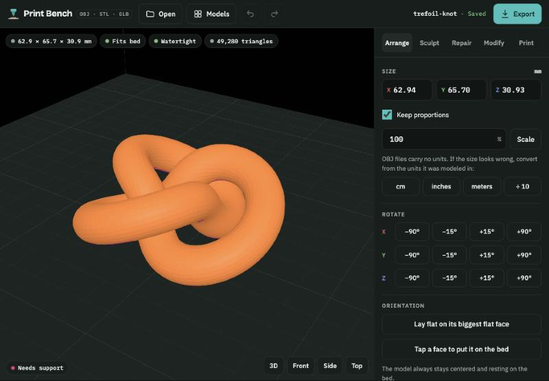
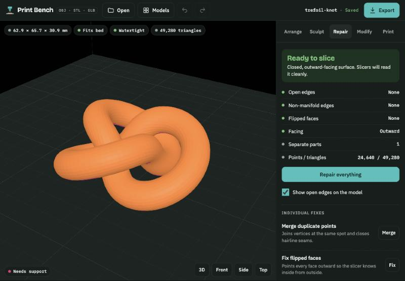
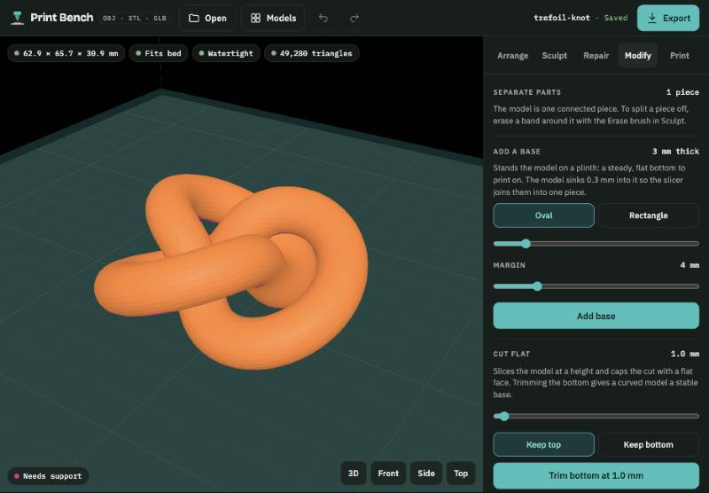
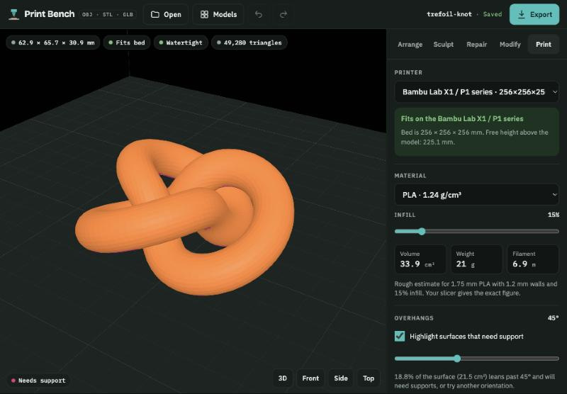
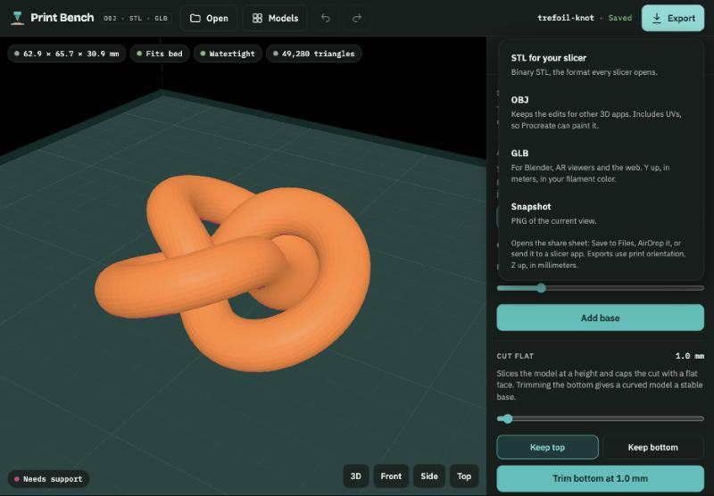

# Print Bench

An iPad app for getting OBJ, STL and GLB models ready to 3D print: resize and orient them, sculpt with Apple Pencil, repair holes and flipped faces, add a base, check the fit on your printer, and export.

Open it at **https://zahra-hasan.github.io/print-bench/**

## Install on iPad

1. Open the link above in **Safari**.
2. Tap the **Share** button, then **Add to Home Screen**.
3. Open **Print Bench** from the Home Screen. It runs full screen and works offline.

## What it does

The badges along the top always show the model's size, whether it fits your printer's bed, whether it's watertight, and how many triangles it has.

### Arrange

Set the size in millimeters, convert models made in other units, rotate in steps, and lay the model flat on its biggest face or on any face you tap.

### Sculpt with Apple Pencil

Six brushes: **Clay** builds up, **Dent** carves in, **Inflate** swells, **Smooth** evens out bumps, **Flatten** levels an area, and **Erase** removes surface. Pencil pressure controls strength, and strokes can be mirrored across X. **Add detail** splits the triangles so brushes can shape finer features.

### Repair

Checks for open edges, non-manifold edges, flipped faces and loose pieces, then fixes them in one tap with **Repair everything**, or one fix at a time.

### Modify

Select and delete separate pieces, add an oval or rectangular base for a steady print, cut the model flat at any height, and reduce triangles on heavy models.

### Print check

Pick your printer and material to see whether the model fits, roughly how much filament and weight it needs, and which surfaces overhang enough to need supports.

### Export

- **STL** for your slicer.
- **OBJ** with UVs, so painting apps like Procreate can open it.
- **GLB** for Blender, AR viewers and the web, in your filament color.
- **Snapshot**, a PNG of the current view.

Export opens the share sheet: Save to Files, AirDrop it, or send it straight to a slicer app.

## Your models

- Every model you open or change saves automatically on the iPad. Tap **Models** to open, rename, copy or delete saved models.
- Models stay on the device and are never uploaded. Deleting the app from the Home Screen deletes its saved models, so export anything you want to keep.
- Compressed GLB files (for example from Tripo) open too.

## Updating

All files are static. After changing any of them, bump `VERSION` in `sw.js` so installed copies pick up the new files. The images in `docs/` are only for this README and are not part of the app.
